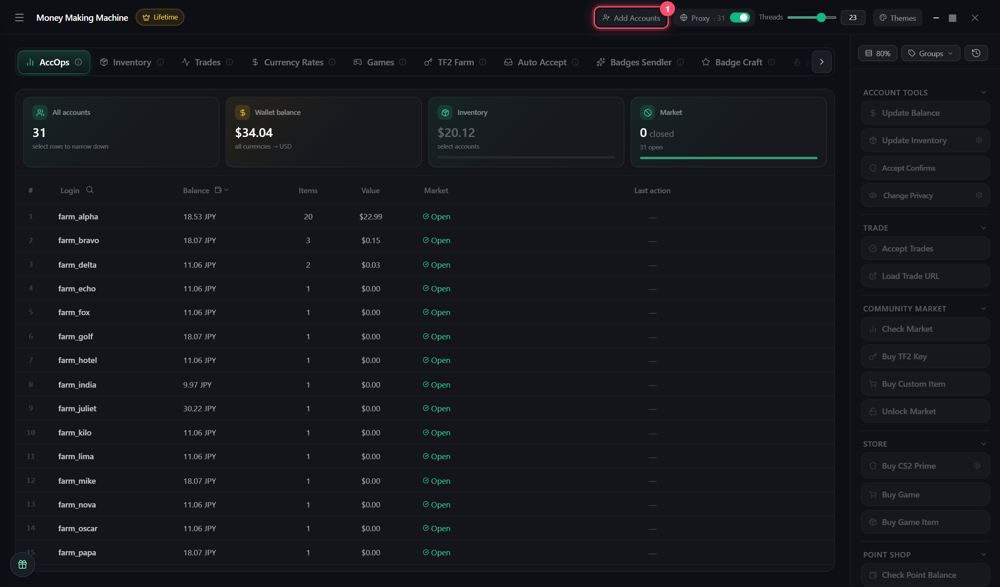

# Import accounts

**Add accounts** in the header → pick:

* `logpass.txt` — lines `login:password`
* the **maFiles** folder — Steam Guard

An account without a maFile is marked **NO MAFS** and doesn't work — add the maFile and import again


Passwords and maFiles are stored in `db\` next to MMM.exe — never share this folder


## Free games

🎁 at the bottom left of AccOps → select accounts → claim
