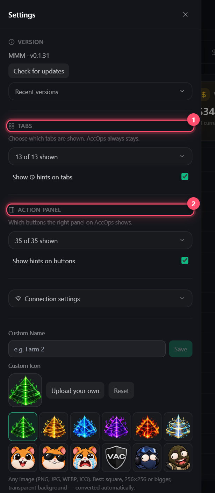

# Settings

The **☰** button, top left

| Item | What for |
|------|----------|
| **Tabs** | Hide tabs you don't use |
| **Action panel** | Hide buttons you don't use. Checkbox **Show hints on buttons** |
| **Language** | English / Русский, instantly |
| **Custom Name / Icon** | Own window name and icon — handy with several copies open |
| **Connection settings** | Proxy timeouts and retries — see below |
| **Hardware acceleration** | Uses the GPU. Turn off if you see colored stripes or the GPU load is too high. Heavy themes are unavailable with it on. Needs a restart |
| **Logs** | **Collect logs for support** → send the archive to support |
| **Version** | **Check for updates** and what's new |

## Connection settings

| Field | Meaning |
|-------|---------|
| Connect / Response timeout, s | How long to wait for the proxy and Steam before switching proxy |
| Proxy switches on error | How many times one action may switch proxy |
| Auto-retry failed accounts, times | How many times failed accounts restart by themselves |

**Themes** and **Threads** — in the header on the right. Threads — how many accounts work at once. More is faster, but Steam limits get more likely


Without a proxy accounts log in one by one with a 45 s pause — this protects your IP

