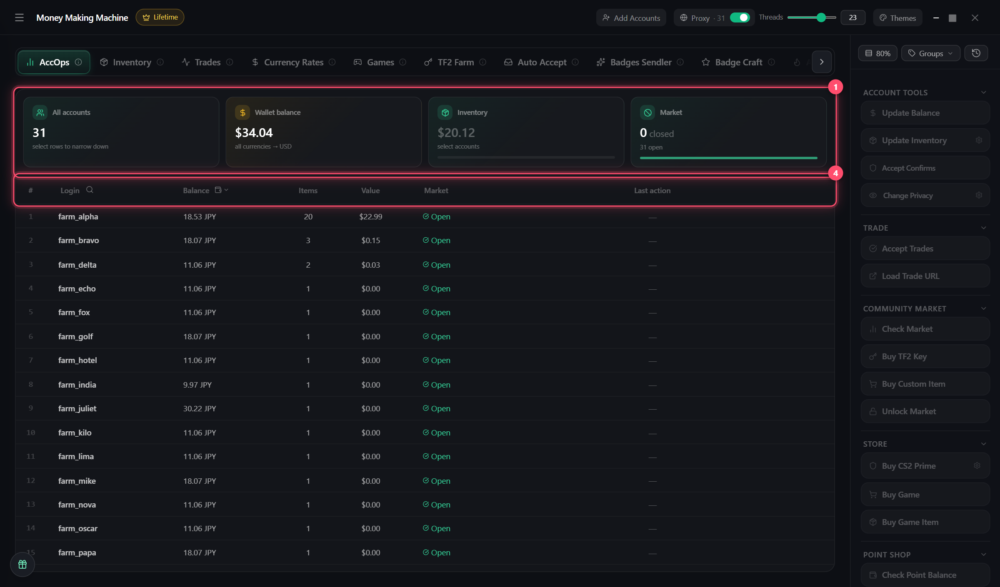

# AccOps

All accounts in one table. **Select rows → press a button on the right**

## Selection

* **Click** — one
* **Shift + click** — range
* **Ctrl + A** — all
* **Search**: `farm`, `12`, `5-10`

## Columns

* **Login**: 🔴 community ban, 🟡 VAC / game ban
* **Market**: open / closed
* **Last action**: `✓` / `✗`. Hover — history
* **Tag**: your own label

## Right click

Copy login, password, 2FA code, trade link · open in browser already logged in · tag · add to trades / badges · delete

Applies to all selected
