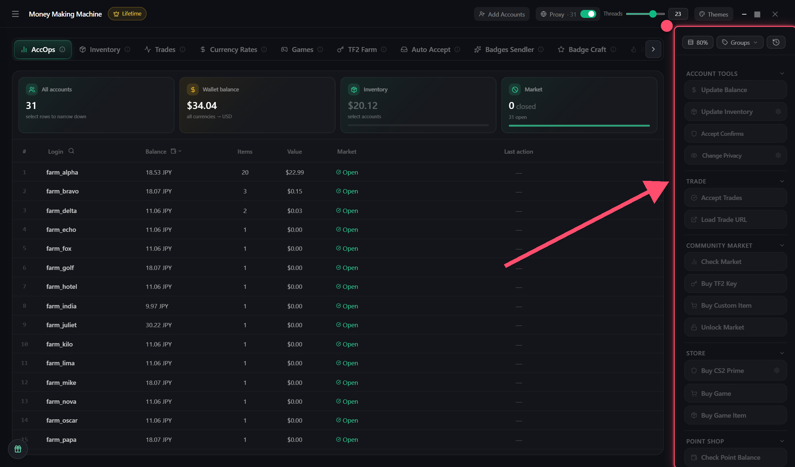

# Action panel

On the right of AccOps. **Select accounts → press a button**. The result goes to "Last action". **Stop** — stop it

## Account Tools

* **Update Balance** — wallet balance and currency
* **Update Inventory** — items and their value. ⚙ — which games
* **Accept Confirms** — mobile confirmations (trades, listings)
* **Change Privacy** — profile privacy settings. ⚙ — which ones

## Trade

* **Accept Trades** — incoming trades. Ones taking the account's items are skipped
* **Load Trade URL** — the account's trade link

## Community Market

* **Check Market** — is the market open
* **Buy TF2 Key** — a key for the whole balance
* **Buy Custom Item** — an item by link
* **Unlock Market** — remove the market hold after a password change

## Store

* **Buy CS2 Prime** — Prime in the Steam store
* **Buy Game** — a game from the store
* **Buy Game Item** — an item from the in-game store

## TF2 Activity

* **Get TF2 information** — backpack capacity, Premium, expanders
* **Activate backpacks** — all backpack expanders
* **Buy Backpack / Key** — an expander or key in the store

## Point Shop

* **Check Point Balance** — how many Steam Points
* **Buy Season Badge** — the badge for points
* **Buy Points Item** — by link, applied to the profile right away

## Account Activation

* **Change Region** — store country. Needs a proxy from that country
* **Activate Game Key** — a game key
* **Activate Gift Code** — a Steam gift code

## Armory

* **Buy Armory Pass** — a pass from the wallet
* **Activate Pass** — get stars
* **Deactivate Pass** — remove a finished pass
* **Check Stars Balance** — how many stars
* **Buy Armory Items** — rewards for stars

## CS2 Activity

* **Get CS2 Level** — CS2 level
* **Check Prime** — is there Prime
* **Check Drop** — the last weekly drop
* **Collect Drop** — collect an uncollected drop

## Account Settings

* **Change Password** — a new random password. Saved to the database and `NewPassword.txt` first, then sent to Steam
* **Change Email** — the account email
* **Check VAC / CT** — VAC, game and trade bans


Purchases are never retried automatically — no double purchases. `✗ No response` — check the account and run again

