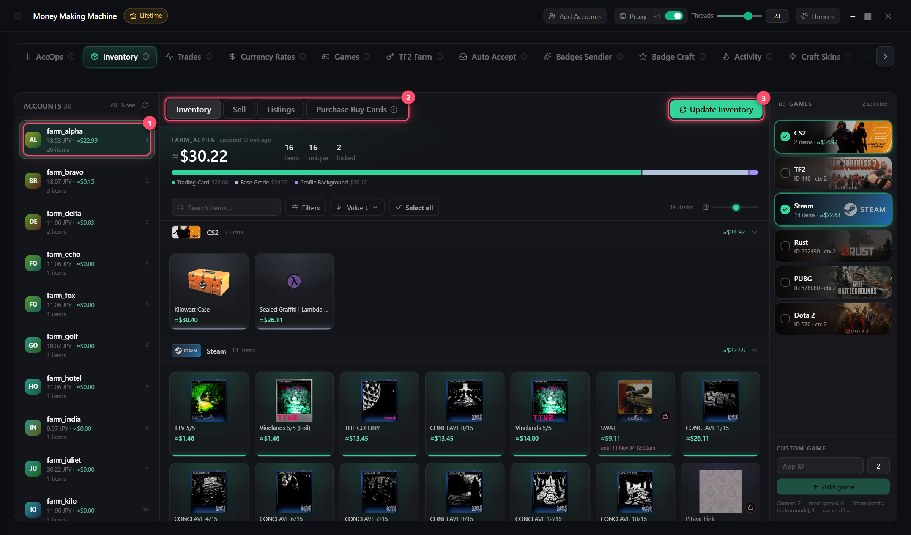

# Inventory

1. Select accounts on the left, games on the right
2. **Update inventory** (12 h cache)
3. Click items → **Sell**

## Sell

| Mode | How |
|------|-----|
| **Min price** | Next to the cheapest listing ± step |
| **Auto-buy** | Into the buy order — instant, but ~15% cheaper |

**Sell for amount** — lists the fewest items to reach a sum (e.g. for Prime)

## Listings

Remove selected / all · **Relist outbid** — relisted at the lowest price

## Purchase Buy Cards

Senders send cards to receivers, they sell them and reach the target sum

1. Senders and receivers
2. Target: Prime, Prime + game, Armory or your own sum
3. **Reserve, %** — how many extra cards
4. **Calculate** → **Send and list**
