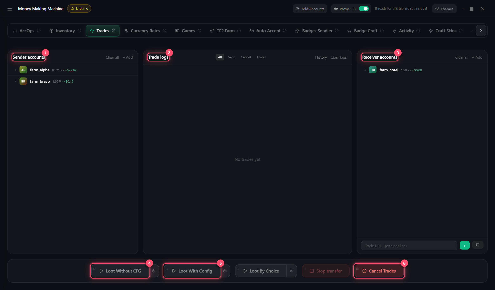

# Trades

Items from senders to receivers

1. **Senders** and **Receivers** (you can paste other trade links too)
2. Loot:
   * **Without config** — everything, ⚙ — which games
   * **With config** — by price, amount and filters, ⚙ — settings
   * **Loot by choice** — 👁 → pick items on each account and who gets them → ▶
3. Summary — what was sent, what's left, what's trade-locked

**Cancel trades** — cancel all sent · **History** — past runs and links


Trades from one account go one by one, different accounts — in parallel

