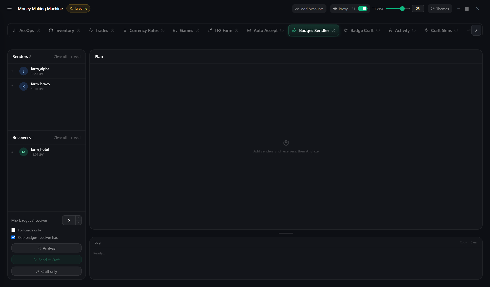

# Badges Sendler

Collects full card sets and crafts badges on receivers

1. **Senders** (cards) and **Receivers** (badges)
2. **Analyze** — plan: which badges and from where
3. **Send and craft**

**Craft only** — from cards already on the receivers
