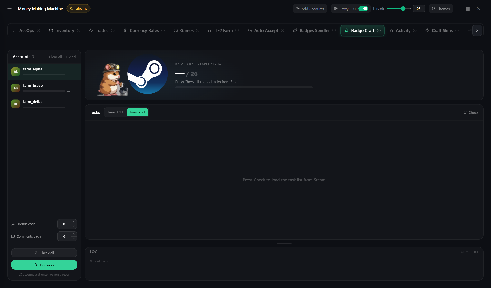

# Badge Craft

Tasks of the "Pillar of Community" badge

1. **+ Add** → **Check all**
2. Target: **Level 1** (13 tasks) or **Level 2** (21)
3. **Run tasks**

Status **manual** — do it yourself, the hint is next to it


An account with less than $5 spent can't add friends, vote or trade — such tasks are marked

