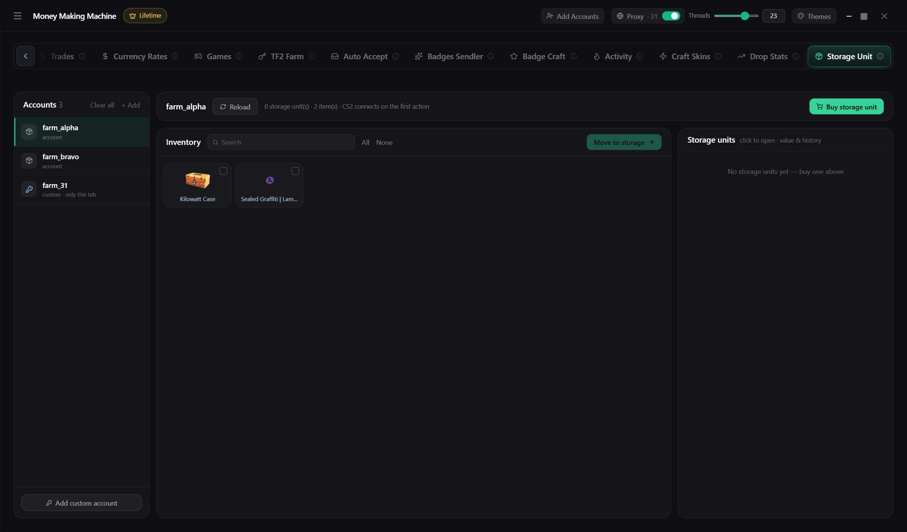

# Storage Unit

CS2 storage units

* Account on the left, inventory in the middle, units on the right
* Pick items → unit → **Move to …**
* Click a unit — contents, value, chart
* **Buy storage unit** — instantly with wallet money. Name it ✏️, otherwise it won't take items. Up to 1000 items

**Add your own account** — login, password, maFile. Works only on this tab
