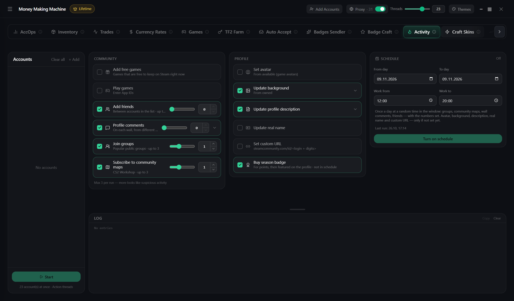

# Activity

Makes accounts look "alive" so Steam suspects them less

1. Pick accounts on the left
2. On the right tick what to do:
   * free games and playing chosen games (Marvel Rivals by default)
   * friends, comments, groups, workshop maps
   * profile: description, background, season badge, avatar, name
3. Run now or on a **schedule** — days and a time window


Groups, maps and comments — no more than 3 per run: more looks suspicious

