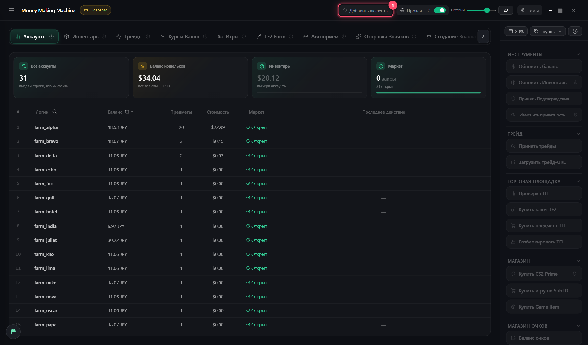

# Импорт аккаунтов

**«Добавить аккаунты»** в шапке → выбери:

* `logpass.txt` — строки `логин:пароль`
* папку **maFiles** — Steam Guard

Аккаунт без maFile помечен **NO MAFS** и не работает — догрузи maFile и импортируй ещё раз


Пароли и maFile лежат в `db\` рядом с MMM.exe — никому не передавай папку


## Бесплатные игры

🎁 внизу слева на вкладке «Аккаунты» → выдели аккаунты → **«Забрать на N акк.»**
