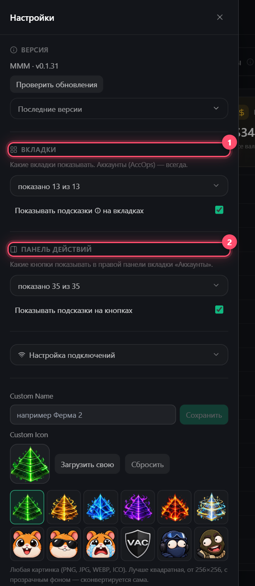

# Настройки

Кнопка **☰** слева вверху

| Пункт | Зачем |
|-------|-------|
| **Вкладки** | Спрятать ненужные вкладки |
| **Панель действий** | Спрятать ненужные кнопки. Галочка **«Показывать подсказки на кнопках»** |
| **Язык** | Русский / English, сразу |
| **Custom Name / Icon** | Своё имя и иконка окна — удобно, когда открыто несколько копий |
| **Настройка подключений** | Таймауты прокси и повторы — см. ниже |
| **Аппаратное ускорение** | Интерфейс рисует видеокарта. Выключи, если видишь цветные полосы или видеокарта сильно нагружена. Тяжёлые темы при нём недоступны. Нужен перезапуск |
| **Логи** | **«Собрать логи для поддержки»** → отправь архив в поддержку |
| **Версия** | **«Проверить обновления»** и что нового |

## Настройка подключений

| Поле | Что значит |
|------|-----------|
| Ожидание подключения / ответа, с | Сколько ждать прокси и Steam, потом — смена прокси |
| Смен прокси при ошибке | Сколько раз одно действие может сменить прокси |
| Автоповтор ошибочных, раз | Сколько раз сами перезапускаются аккаунты с ошибкой |

**Темы** и **Потоки** — в шапке справа. Потоки — сколько аккаунтов работают одновременно. Больше — быстрее, но выше шанс лимитов Steam


Без прокси аккаунты входят по одному с паузой 45 с — это защита твоего IP

