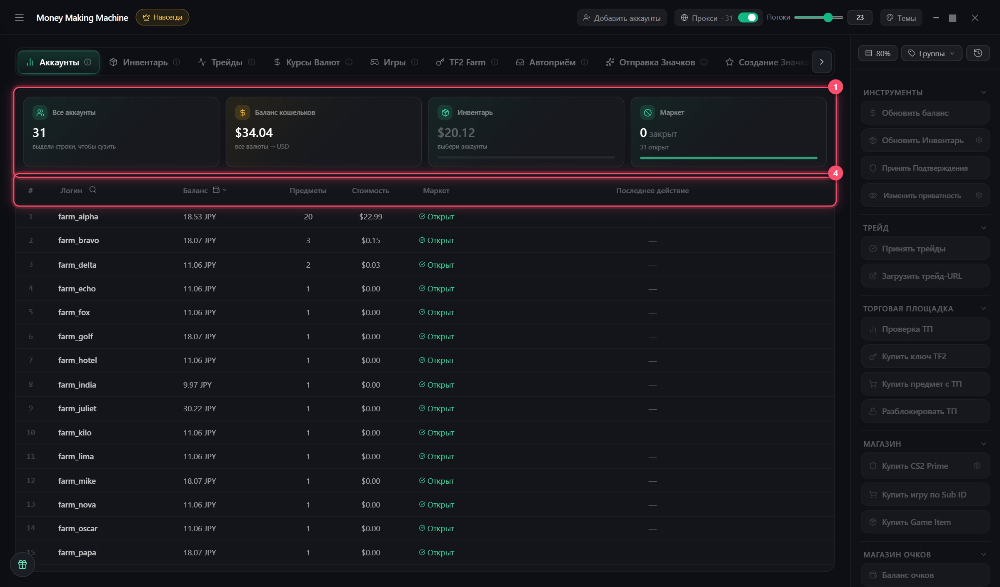

# Аккаунты

Все аккаунты в одной таблице. **Выдели строки → нажми кнопку справа**

## Выделение

* **Клик** — один
* **Shift + клик** — диапазон
* **Ctrl + A** — все
* **Поиск**: `farm`, `12`, `5-10`

## Столбцы

* **Логин**: 🔴 бан сообщества, 🟡 VAC / игровой бан
* **Маркет**: открыт / закрыт
* **Последнее действие**: `✓` / `✗`. Наведи — история
* **Тег**: своя метка

## Правый клик

Скопировать логин, пароль, код 2FA, трейд-ссылку · открыть в браузере уже залогиненным · тег · добавить в трейды / значки · удалить

Действует на все выделенные
