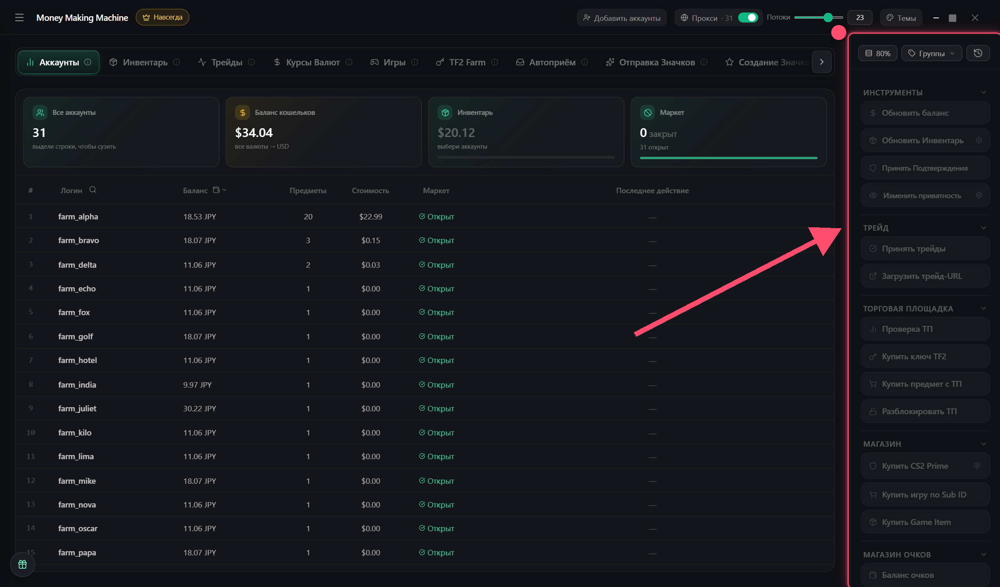

# Панель действий

Справа на вкладке «Аккаунты». **Выдели аккаунты → нажми кнопку**. Результат — в столбце «Последнее действие». **Стоп** — остановить

## Инструменты

* **Обновить баланс** — баланс кошелька и валюта
* **Обновить инвентарь** — предметы и их стоимость. ⚙ — какие игры
* **Принять подтверждения** — мобильные подтверждения (трейды, лоты)
* **Изменить приватность** — настройки приватности профиля. ⚙ — какие именно

## Трейд

* **Принять трейды** — входящие трейды. Где у аккаунта забирают предметы — пропускаются
* **Загрузить трейд-URL** — трейд-ссылка аккаунта

## Торговая площадка

* **Проверка ТП** — открыт ли маркет
* **Купить ключ TF2** — ключ на весь баланс
* **Купить предмет с ТП** — предмет по ссылке
* **Разблокировать ТП** — снять блокировку маркета после смены пароля

## Магазин

* **Купить CS2 Prime** — Prime в магазине Steam
* **Купить игру по Sub ID** — игра из магазина
* **Купить Game Item** — предмет из игрового магазина

## Активность TF2

* **Узнать информацию** — вместимость рюкзака, Premium, расширители
* **Активировать рюкзаки** — все расширители рюкзака
* **Купить рюкзак / ключ** — расширитель или ключ в магазине

## Магазин очков

* **Баланс очков** — сколько очков Steam
* **Купить значок сезона** — значок за очки
* **Купить предмет за очки** — по ссылке, сразу ставится в профиль

## Активация на аккаунте

* **Сменить регион** — страна магазина. Нужен прокси этой страны
* **Активировать Game Key** — ключ игры
* **Активировать Gift Code** — подарочный код Steam

## Armory

* **Купить Armory Pass** — пропуск с кошелька
* **Активировать Pass** — получить звёзды
* **Деактивировать Pass** — снять завершённый пропуск
* **Баланс звёзд** — сколько звёзд
* **Купить за звёзды** — награды за звёзды

## Активность CS2

* **Узнать уровень** — уровень в CS2
* **Проверка Prime** — есть ли Prime
* **Проверить дроп** — последний еженедельный дроп
* **Забрать дроп** — забрать незабранный дроп

## Настройки аккаунта

* **Сменить пароль** — новый случайный пароль. Сначала сохраняется в базу и `NewPassword.txt`, потом уходит в Steam
* **Сменить почту** — почта аккаунта
* **Проверить VAC / CT** — VAC, игровые и трейд-баны


Покупки не повторяются сами — двойной покупки не будет. `✗ Нет ответа` — проверь аккаунт и запусти ещё раз

