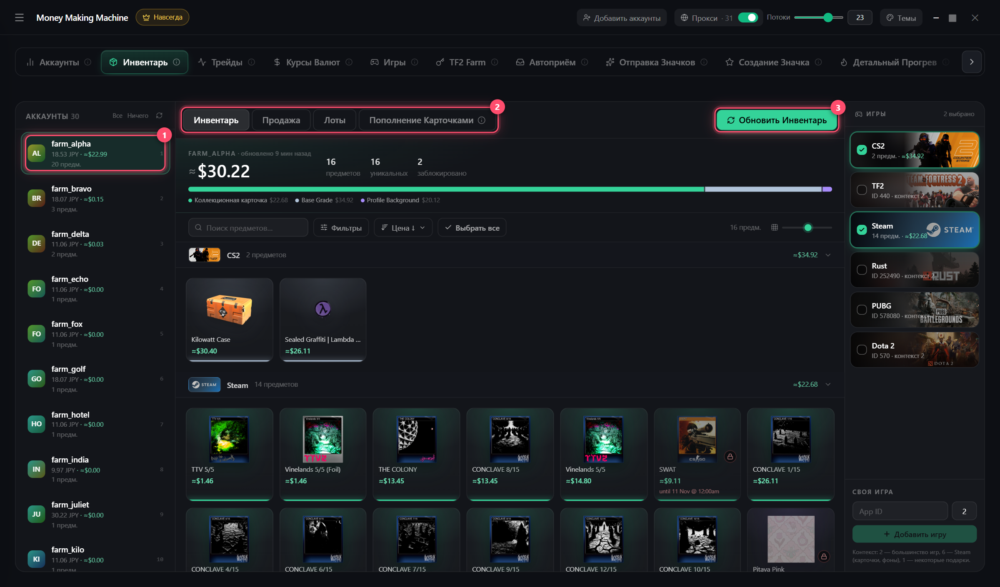

# Инвентарь

1. Слева выдели аккаунты, справа — игры
2. **«Обновить инвентарь»** (кэш 12 ч)
3. Кликни предметы → **Продажа**

## Продажа

| Режим | Как |
|-------|-----|
| **Мин. цена** | Рядом с самым дешёвым лотом ± шаг |
| **Автопокупка** | По ордеру — сразу, но ~15% дешевле |

**Продать на сумму** — выставит минимум предметов, чтобы набрать сумму (например, на Prime)

## Лоты

Снять выбранные / все · **«Перевыставить перебитые»** — встанут по самой низкой цене

## Пополнение карточками

Отправители шлют карточки получателям, те продают и набирают сумму на цель

1. Отправители и получатели
2. Цель: Prime, Prime + игра, Armory или своя сумма
3. **Запас, %** — сколько карточек сверху
4. **Рассчитать** → **«Отправить и выставить»**
