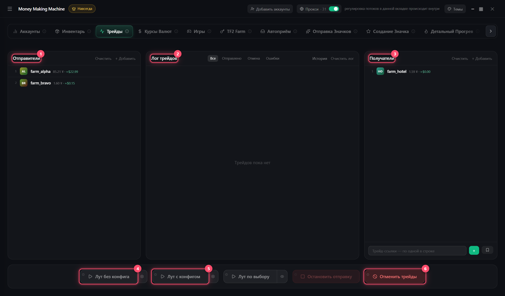

# Трейды

Предметы с отправителей на получателей

1. **Отправители** и **Получатели** (можно вставить чужие трейд-ссылки)
2. Лут:
   * **Без конфига** — всё подряд, ⚙ — какие игры
   * **С конфигом** — по цене, количеству и фильтрам, ⚙ — настройки
   * **По выбору** — 👁 → выбери предметы на каждом аккаунте и кому их отдать → ▶
3. Итог — сколько ушло, что осталось, что в трейд-локе

**Отменить трейды** — снять все отправленные · **История** — прошлые запуски и ссылки


С одного аккаунта трейды идут по очереди, разные аккаунты — параллельно

