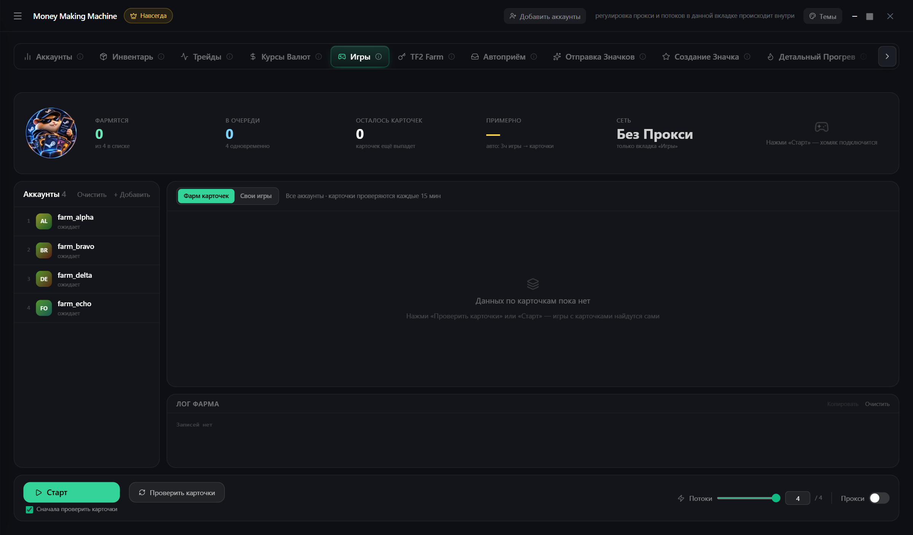

# Игры

Аккаунты «играют» без запуска Steam — падают карточки, идут часы

1. **+ Добавить** аккаунты
2. Режим:
   * **Фарм карточек** — сам находит игры с карточками
   * **Свои игры** — часы в выбранных App ID
3. **Старт**

Аккаунты появляются в работе по мере проверки карточек · **Проверить карточки** — без запуска · **Потоки** — сколько фармят одновременно
