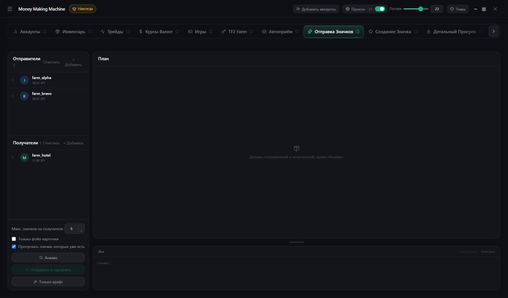

# Отправка значков

Собирает полные наборы карточек и крафтит значки на получателях

1. **Отправители** (карточки) и **Получатели** (значки)
2. **Анализ** — план: какие значки и откуда
3. **Отправить и скрафтить**

**Только крафт** — из карточек, которые уже лежат на получателях
