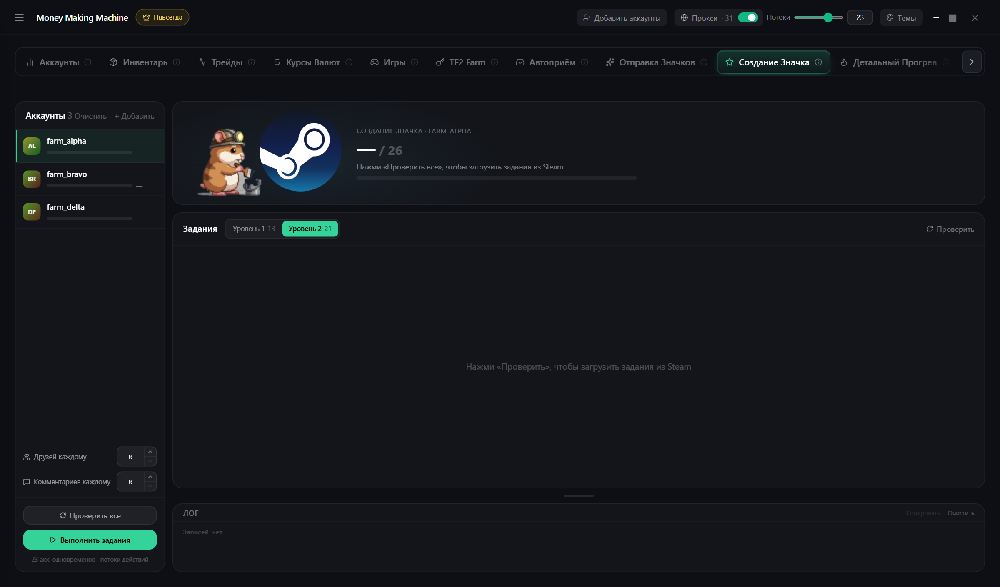

# Создание значка

Задания значка «Столп сообщества»

1. **+ Добавить** → **Проверить все**
2. Цель: **Уровень 1** (13 заданий) или **Уровень 2** (21)
3. **Выполнить задания**

Статус **вручную** — сделай сам, подсказка рядом


Аккаунт без $5 покупок не может дружить, голосовать и торговать — такие задания помечены

