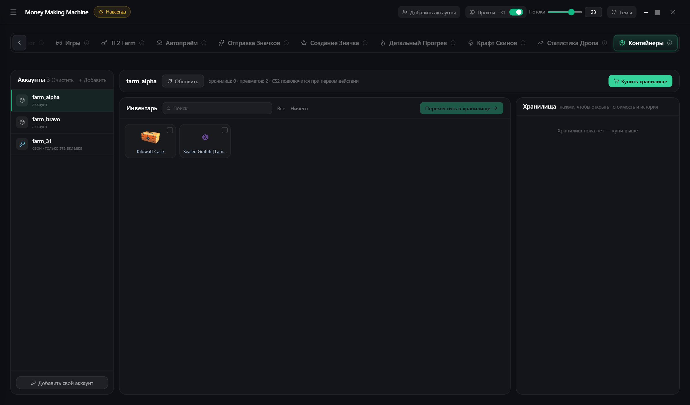

# Контейнеры

Storage Unit CS2

* Слева аккаунт, посередине инвентарь, справа контейнеры
* Выбери предметы → контейнер → **«Переместить в …»**
* Клик по контейнеру — содержимое, стоимость, график
* **Купить хранилище** — сразу за деньги кошелька. Дай имя ✏️, иначе не примет предметы. До 1000 предметов

**Добавить свой аккаунт** — логин, пароль, maFile. Работает только на этой вкладке
