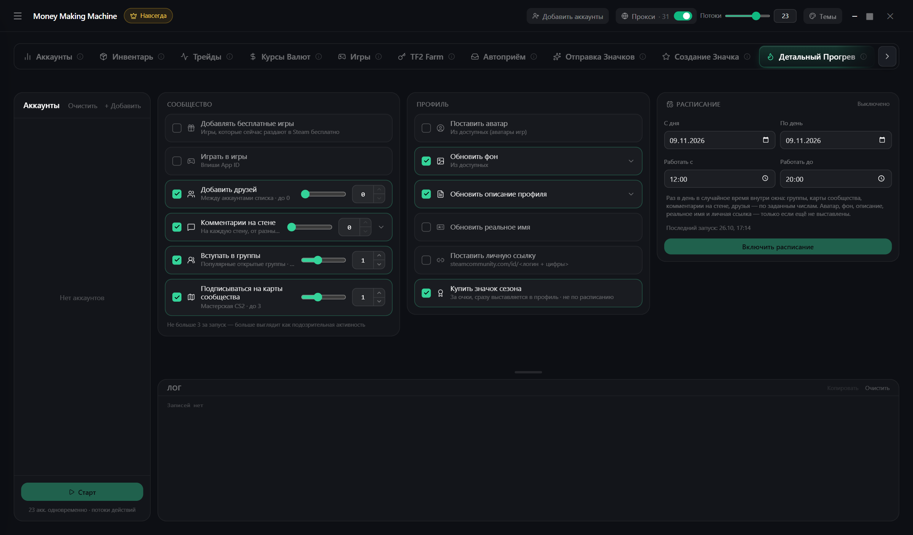

# Детальный прогрев

Делает аккаунты «живыми», чтобы Steam меньше их подозревал

1. Слева выбери аккаунты
2. Справа отметь, что делать:
   * бесплатные игры и игра в выбранные (по умолчанию Marvel Rivals)
   * друзья, комментарии, группы, карты мастерской
   * профиль: описание, фон, значок сезона, аватар, имя
3. Запусти сразу или по **расписанию** — дни и окно времени


Группы, карты и комментарии — не больше 3 за запуск: больше выглядит подозрительно

